# Dossier d'architecture technique

## HIMRA ULTRA TRACKLIST EXPERIENCE

| | |
|---|---|
| **Version** | 1.0 |
| **Date** | 26 novembre 2026 |
| **Statut** | **Validé le 26 novembre 2026** (versions arrêtées, ADR acceptés) |
| **Entrées** | Cahier des charges v5.0, document de cadrage v1.0 (validé) |
| **Contraintes structurantes** | Budget nul, smartphones modestes, pics de trafic, aucune donnée personnelle hormis le pseudonyme |

Ce dossier décrit **comment** le produit est construit. Il ne contient pas de code d'implémentation. Les signatures et contrats qui y figurent sont normatifs : le code devra s'y conformer.

---

## 1. Principes d'architecture

| N° | Principe | Application |
|---|---|---|
| P1 | **Le statique d'abord** | Tout ce qui peut être un fichier sur CDN en est un. Le serveur n'intervient que pour ce qui l'exige. |
| P2 | **Trois couches étanches** | Navigateur (présentation), Worker (frontière de confiance publique), PostgreSQL (vérité et règles). Chaque couche valide ce qu'elle reçoit. |
| P3 | **La base est la dernière ligne de défense** | Les règles métier critiques et les droits sont codés dans PostgreSQL (contraintes, fonctions, RLS), pas seulement dans le code applicatif. |
| P4 | **Le moindre privilège** | Le rôle public (`anon`) n'accède à **aucune table** : seulement à 4 fonctions de lecture. Le Worker détient la seule clé capable d'écrire une participation. |
| P5 | **Écrire peu, lire du précalculé** | Une participation = une ligne. Les classements sont précalculés en une ligne JSON. |
| P6 | **Zéro dépendance de confort** | Une bibliothèque n'entre que si son absence coûte plus cher (en temps, en sécurité ou en accessibilité) que son poids. Chaque dépendance est justifiée (§10). |
| P7 | **Un seul vocabulaire d'erreurs** | Des codes d'erreur partagés entre la base, le Worker et l'interface. Un seul endroit traduit un code en message pour l'humain. |
| P8 | **Portable** | PostgreSQL standard et un Worker basé sur l'API `fetch` standard. Une migration vers un autre hébergeur reste possible sans réécriture. |

---

## 2. Stack technique argumentée

### 2.1. Choix retenus

| Couche | Technologie | Pourquoi ce choix | Alternatives écartées |
|---|---|---|---|
| Langage | **TypeScript 6.0** (strict) | Un seul langage du navigateur au Worker. Les types et schémas sont partagés, ce qui évite les divergences de règles. | JavaScript seul : pas de contrat vérifié entre les couches |
| UI | **React 19** | Imposé par le CDC. Écosystème accessible (dnd-kit). Compétence disponible. | Preact (plus léger mais compatibilité dnd-kit et Motion moins sûre), Svelte (hors CDC) |
| Build | **Vite 8** | Build rapide, découpage par route natif, mode SSR utilisable pour le prérendu sans plugin | Next.js (exige un runtime serveur, inutile ici) |
| Styles | **Tailwind CSS 4** | Tokens du design system en variables CSS (`@theme`), CSS final minimal, pas de CSS-in-JS au runtime | CSS Modules (possible, mais les tokens sont moins outillés) |
| Routage | **React Router 8** (mode bibliothèque) | Routes déclaratives, `lazy()` par route. Le mode framework n'est pas utilisé, faute de besoin de SSR. | TanStack Router (plus lourd pour 15 routes) |
| Animations | **Motion 14** (`motion/react`, ex-Framer Motion) avec `LazyMotion` + `domAnimation` | Imposé par le CDC. `LazyMotion` réduit la charge initiale à environ 5 Ko et charge le reste à la demande. | Animations CSS seules (insuffisantes pour la réorganisation et les transitions de présence) |
| Glisser-déposer | **dnd-kit** (`core` + `sortable`) | Tactile, clavier et annonces pour lecteurs d'écran inclus : l'accessibilité est un critère d'acceptation | Développement maison (très coûteux à rendre accessible) |
| Validation | **Zod 4** | Un seul schéma pour le navigateur et le Worker, messages structurés par champ | Validation écrite à la main (deux implémentations qui divergeraient) |
| Carte PNG | **html-to-image** | Rendu DOM vers PNG dans le navigateur, sans serveur ni CPU facturable. Chargé à la demande. | Rendu côté serveur (Satori et Resvg dépassent les 10 ms de CPU de l'offre gratuite) |
| PWA | **vite-plugin-pwa** (Workbox) | Manifest et service worker générés, stratégies de cache déclaratives, message de mise à jour | Service worker écrit à la main (risque de cache obsolète) |
| Edge et API | **Cloudflare Workers + Static Assets** | Fichiers statiques gratuits et illimités, 100 000 requêtes de fonctions par jour, HTMLRewriter natif pour les balises OG | Netlify (crédits épuisables, puis suspension), Vercel Hobby (usage commercial ambigu, quotas de fonctions) |
| Anti-robot | **Cloudflare Turnstile** | Gratuit, invisible dans la plupart des cas, sans cookie de suivi publicitaire | hCaptcha (plus intrusif), reCAPTCHA (cookies Google, besoin de consentement) |
| Base de données | **Supabase PostgreSQL** | Vrai Postgres : transactions, contraintes, RLS, pg_cron, unaccent. Offre gratuite suffisante. | D1/SQLite (100 000 lignes écrites par jour en gratuit, RLS absente, Auth à reconstruire) |
| Auth admin | **Supabase Auth** + TOTP | MFA native, JWT lisible par RLS (`aal2`), aucun code d'authentification maison | Cloudflare Access (protège la route mais pas les données), Auth maison (risque) |
| Stockage d'images | **Supabase Storage** (bucket public) | 1 Go gratuit, CDN, politiques d'écriture réservées à l'admin | Images versionnées dans le dépôt (chaque changement de pochette exigerait un déploiement) |
| Tâches planifiées | **pg_cron** | Dans la base, sans service externe, à la minute près | Cron Trigger Cloudflare (requêtes de fonctions consommées, latence réseau en plus) |
| Mesure d'audience | **Cloudflare Web Analytics** | Gratuit, sans cookie, pas de bannière | Plausible (payant), GA4 (cookies, consentement) |
| Erreurs navigateur | **Sentry** (`@sentry/browser`, chargé après le rendu) | 5 000 erreurs par mois gratuites, traces lisibles, PII désactivées | GlitchTip auto-hébergé (pas de serveur gratuit pour l'héberger) |
| Journaux serveur | **Workers Logs** | Inclus, JSON structuré, aucune dépendance | Sentry dans le Worker (dépendance en plus, CPU en plus) |
| CI/CD | **GitHub Actions** + **Wrangler** + **Supabase CLI** | Gratuit, déploiement conditionné à la CI | Workers Builds (ne bloque pas le déploiement sur l'échec des tests SQL) |
| Tests | **Vitest**, **Playwright** + **axe-core**, **tests SQL** (Supabase CLI), **k6** | Couvrent chaque couche, tous gratuits | Cypress (plus lourd, moins bon sur WebKit) |

### 2.2. Ce qui n'est volontairement pas utilisé

| Outil courant | Raison du refus |
|---|---|
| Redux, Zustand, Jotai | L'état global se réduit au brouillon. Un petit store (`useSyncExternalStore`) suffit. |
| TanStack Query, SWR | 4 lectures publiques. Un hook de lecture maison (cache mémoire, temps de validité, annulation) suffit en moins de 80 lignes. |
| `@supabase/supabase-js` côté public | Environ 45 Ko compressés pour 4 appels RPC. Le public utilise `fetch`, et la bibliothèque est chargée **uniquement dans le module admin**. |
| Bibliothèque de formulaires | Un seul champ public. L'admin a des formulaires simples. |
| Bibliothèque de dates | `Intl.DateTimeFormat('fr-CI')` couvre JJ/MM/AAAA et l'heure. |
| Recharts ou autre bibliothèque de graphiques | Barres horizontales en CSS (`transform: scaleX`) |
| Kit de composants (MUI, shadcn…) | Design sur mesure obligatoire. Les composants génériques produiraient l'esthétique bannie. |
| Hono ou autre framework pour le Worker | 3 routes, un routeur de 30 lignes suffit |
| Axios | `fetch` et `AbortController` sont natifs |
| Lodash, utilitaires génériques | Fonctions natives |

---

## 3. Architecture générale

### 3.1. Vue d'ensemble

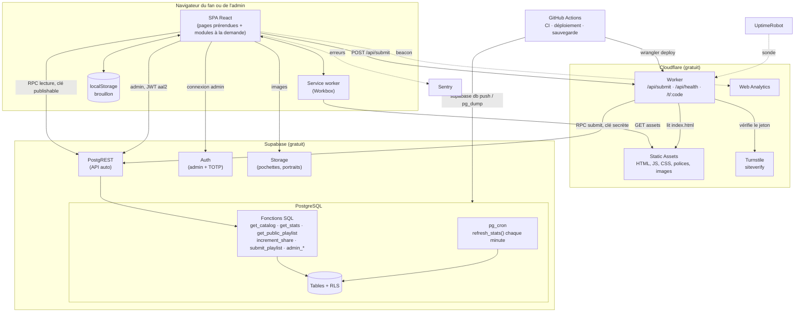

### 3.2. Responsabilités par couche

| Couche | Responsable de | N'est jamais responsable de |
|---|---|---|
| **Navigateur (SPA)** | Affichage, interactions, brouillon local, validation de confort, génération de la carte, appels API, traduction des codes d'erreur en messages | Décider qu'une participation est valide, calculer des classements, détenir un secret |
| **Worker (edge)** | Frontière de confiance pour les écritures publiques : taille de requête, honeypot, Turnstile, validation Zod, appel de `submit_playlist`. Balises OG des tracklists. En-têtes de sécurité des réponses dynamiques. Journaux. | Stocker des données, calculer des classements, servir l'admin |
| **PostgreSQL** | Vérité des données, règles métier finales (campagne ouverte, éléments actifs, limites, termes interdits), atomicité, idempotence, droits (RLS), calcul des classements, audit | Rendu, présentation, messages destinés à l'humain |
| **Supabase Auth** | Identité de l'admin, MFA, émission des JWT | Autorisation (portée par RLS et `is_admin()`) |
| **CI/CD** | Qualité (tests, lint, audit), migrations, déploiement, sauvegardes, maintien en activité | Toute décision métier |

### 3.3. Frontières de confiance

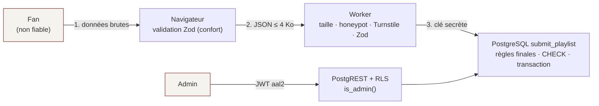

Une donnée qui franchit une frontière est revalidée. Rien de ce qui vient du navigateur n'est tenu pour vrai.

### 3.4. Tenue en charge : où passe chaque requête

| Requête | Volume relatif | Destination | Coût marginal |
|---|---|---|---|
| Pages, JS, CSS, polices, images de l'interface | Très élevé | CDN Cloudflare | Nul, sans quota |
| `get_catalog` | 1 par visite (puis cache du service worker) | PostgREST | Environ 15 Ko de trafic sortant |
| `get_stats` | 1 par minute et par onglet visible sur les résultats, plus 1 par visite de l'accueil | PostgREST, lecture d'une ligne | Environ 1,5 Ko |
| `/api/submit` | 1 par participation | Worker, puis PostgREST | 1 requête Worker, 1 insertion |
| `/t/:code` | 1 par ouverture de lien partagé | Worker (cache de 60 s), puis PostgREST | 1 requête Worker |
| `refresh_stats` | 1 par minute | pg_cron | Indépendant du trafic |

---

## 4. Architecture frontend

### 4.1. Organisation en modules

Le frontend est découpé **par fonctionnalité** (features), avec une couche partagée minimale. Une feature n'importe jamais une autre feature directement : elles passent par `shared/` ou par les pages.

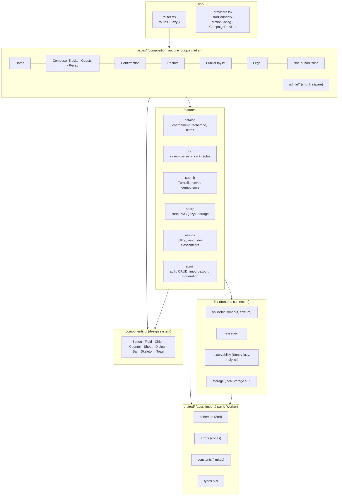

### 4.2. Responsabilités des modules

| Module | Responsabilité | Expose |
|---|---|---|
| `features/catalog` | Charger le catalogue via `get_catalog`, l'indexer (titre normalisé sans accents), rechercher et filtrer en mémoire | `useCatalog()`, `searchTracks(query, filters)` |
| `features/draft` | État du brouillon : morceaux ordonnés, guests, pseudo, clé d'idempotence, instant de début. Applique RG-TRK et RG-GST. Persistance versionnée. Purge des éléments devenus inactifs. | `useDraft()`, actions `addTrack`, `removeTrack`, `moveTrack`, `toggleGuest`, `setNickname`, `reset` |
| `features/submit` | Obtenir le jeton Turnstile, construire la requête, l'envoyer, interpréter le résultat, effacer le brouillon après un succès | `useSubmit()` qui renvoie `{ status, error, submit }` |
| `features/share` | Rendre la carte (composant React hors écran), l'exporter en PNG (html-to-image chargé à la demande), lancer le partage WhatsApp, natif ou par copie, compter le clic | `ShareCard`, `useShare()` |
| `features/results` | Interroger `get_stats` toutes les 60 s quand l'onglet est visible, avec un décalage aléatoire. Garder le dernier état connu. Animer seulement les valeurs qui ont changé. | `useStats()` |
| `features/admin` | Session Supabase, garde des routes admin, CRUD, import et export CSV, modération, journal, tableau de bord | Pages admin |
| `lib/api` | Client HTTP unique : timeout de 10 s, conversion des réponses en `Result<T, ApiError>`, ajout de l'en-tête `X-Request-Id` | `apiGet`, `apiPost`, `rpc()` |
| `lib/messages.fr` | **Seul endroit** où un code d'erreur devient un texte affiché | `messageFor(code, context)` |
| `lib/observability` | Initialiser Sentry après le premier rendu, avec un tampon des erreurs survenues avant. Événements d'analytics. | `reportError()`, `track()` |
| `lib/storage` | Accès à `localStorage` dans un try/catch, avec repli en mémoire | `safeStorage` |
| `shared/*` | Schémas Zod, codes d'erreur, limites, types des contrats API. **Aucun import de React ni du DOM.** | Importé par le frontend et le Worker |

### 4.3. Routes

| Chemin | Page | Chargement | Prérendu | Indexation |
|---|---|---|---|---|
| `/` | Accueil | Initial | Oui | Oui |
| `/composer/morceaux` | Étape Morceaux | Lazy (avec dnd-kit) | Non | Oui |
| `/composer/guests` | Étape Guests | Lazy | Non | Non |
| `/composer/recap` | Récapitulatif | Lazy (avec Turnstile) | Non | Non |
| `/merci/:code` | Confirmation et carte | Lazy (html-to-image à la demande) | Non | Non |
| `/resultats` | Résultats | Lazy | Coquille seulement | Oui |
| `/t/:code` | Tracklist publique | Lazy, avec OG injectées par le Worker | Non | **Non** |
| `/mentions-legales`, `/confidentialite`, `/conditions` | Pages légales | Lazy | Oui | Oui |
| `/hors-ligne` | Page hors ligne | Précachée | Oui | Non |
| `/admin/*` | Espace admin | Chunk séparé (avec supabase-js et papaparse) | Non | **Non** |
| `*` | 404 | Initial | Oui | Non |

Chaque étape de composition a son propre chemin, ce qui permet de mesurer l'entonnoir dans Web Analytics (accueil, puis morceaux, guests, récapitulatif, merci) sans événement personnalisé.

### 4.4. Gestion de l'état

| Type d'état | Où il vit | Mécanisme |
|---|---|---|
| Brouillon de participation | `features/draft` | Store externe et `useSyncExternalStore`, persistance `localStorage` (clé `hute:draft:v1`) écrite au plus toutes les 300 ms |
| Données serveur publiques | `features/*` | Hook `useResource(key, fetcher, { staleTime })` : cache mémoire et annulation au démontage |
| Paramètres de campagne | `CampaignProvider` | Contexte React alimenté par `get_catalog` |
| Session admin | `features/admin` | supabase-js (dans le chunk admin seulement) |
| État d'interface (tiroir ouvert, filtres) | Composants | `useState`. Les filtres sont aussi dans l'URL (`?projet=…&type=…`). |

Le brouillon persisté suit ce schéma :

```ts
type DraftV1 = {
  v: 1;
  trackIds: number[];        // ordre = position
  guestIds: number[];
  nickname: string;
  idempotencyKey: string;    // crypto.randomUUID(), renouvelé après succès
  startedAt: number;         // Date.now() à l'entrée dans /composer (D-2)
  updatedAt: number;
};
```

Un brouillon dont la version est inconnue ou illisible est abandonné sans erreur bloquante.

### 4.5. Prérendu et amélioration progressive

- Le build (Vite 8) fait deux passes. Une passe client (Vite) produit le bundle. Une passe SSR (`vite build --ssr`) produit un module de rendu, qu'un script de build (`scripts/prerender.ts`, sans dépendance) exécute avec `react-dom/server` pour écrire le HTML de `/`, des pages légales, de `/resultats` (coquille), de `/hors-ligne` et de la 404.
- Les pages prérendues contiennent le texte, les balises SEO et OG, le JSON-LD, et un `<noscript>` qui explique que la composition exige JavaScript.
- Les compteurs de l'accueil sont prérendus avec une valeur neutre (« … »), sans fausse valeur, puis remplis au chargement. Leur espace est réservé pour éviter tout décalage de mise en page.

### 4.6. Budgets par chunk (compressés)

| Chunk | Contenu | Budget |
|---|---|---|
| `entry` | React, routeur, providers, design system de base, accueil | 110 Ko |
| `motion` | `LazyMotion` + `domAnimation` | 20 Ko (chargé après le premier rendu) |
| `compose` | Morceaux, guests, récap, dnd-kit, Zod | 60 Ko |
| `share` | html-to-image | 15 Ko (à la demande) |
| `results` | Page de résultats | 15 Ko |
| `admin` | supabase-js, papaparse, pages admin | 150 Ko (hors budget public) |
| Polices | 2 familles en WOFF2, sous-ensemble latin | 120 Ko au total |

Ces budgets sont contrôlés en CI : le build échoue s'ils sont dépassés.

### 4.7. Validation côté client

- Le schéma Zod `SubmissionSchema` (dans `shared/`) est le même que celui du Worker.
- Le pseudo est validé quand le champ perd le focus, puis à chaque frappe une fois qu'une erreur est affichée. Le message apparaît sous le champ et il est relié au champ par `aria-describedby`.
- Les limites (20 morceaux, 5 guests) sont appliquées **avant** l'action : le bouton d'ajout signale la limite, aucune erreur ne survient après coup.
- Les attributs HTML complètent Zod : `maxlength="24"`, `autocomplete="nickname"`, `enterkeyhint="done"`, `inputmode="text"`.
- La liste des termes interdits n'est **pas** envoyée au navigateur, pour ne pas faciliter son contournement. Seul le serveur la vérifie, et l'erreur revient inline sur le champ. C'est un écart assumé par rapport à RG-PSE-06, enregistré dans l'ADR-006.

---

## 5. Architecture backend

Le « backend » comporte deux parties : le **Worker** (frontière publique) et **PostgreSQL** (logique et données). Il n'y a pas de serveur d'application permanent.

### 5.1. Worker Cloudflare

#### 5.1.1. Modules

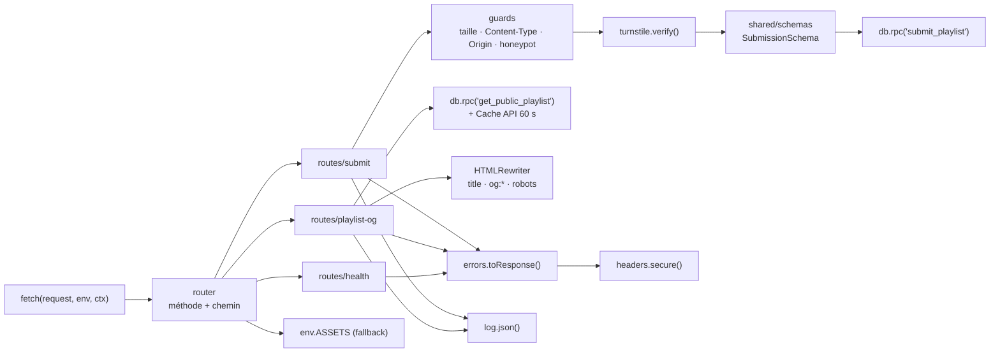

| Module | Responsabilité |
|---|---|
| `index.ts` | Point d'entrée. Enveloppe chaque requête dans `withErrorHandling` et génère le `requestId`. |
| `router.ts` | Correspondance méthode et chemin vers un handler. Renvoie 404 ou 405 sinon. |
| `routes/submit.ts` | Orchestration de la soumission |
| `routes/playlist-og.ts` | Injection des balises de `/t/:code` |
| `routes/health.ts` | `GET /api/health` : `{ ok: true, version }`, sans appel à la base, pour UptimeRobot |
| `guards.ts` | Taille (4 096 octets au maximum, lue en flux), `Content-Type: application/json`, contrôle `Origin` (liste blanche), honeypot |
| `turnstile.ts` | Appel à `siteverify` avec un timeout de 3 s. Le `hostname` et l'`action` (`submit`) sont vérifiés. |
| `db.ts` | Client PostgREST minimal (`fetch` vers `/rest/v1/rpc/*`), timeout de 5 s, conversion des erreurs SQL en `AppError` |
| `errors.ts` | `AppError`, table code vers statut HTTP, `toResponse()` |
| `headers.ts` | En-têtes de sécurité des réponses dynamiques, CORS limité à la même origine |
| `log.ts` | Une ligne JSON par requête : `requestId`, route, statut, durée, code d'erreur. **Ni IP, ni pseudo, ni corps de requête.** |

#### 5.1.2. Configuration de diffusion (`wrangler.toml`, extrait normatif)

| Clé | Valeur | Effet |
|---|---|---|
| `assets.directory` | `./dist` | Fichiers statiques servis par Cloudflare |
| `assets.not_found_handling` | `single-page-application` | Toute route inconnue renvoie `index.html` (routage côté client) |
| `assets.run_worker_first` | `["/api/*", "/t/*"]` | Le Worker ne s'exécute **que** sur ces chemins. Le reste ne consomme aucune requête de fonction. |
| `compatibility_date` | Fixée au lot L0 | Comportement stable |
| `observability.enabled` | `true` | Workers Logs |
| Secrets | `SUPABASE_SECRET_KEY`, `TURNSTILE_SECRET_KEY` | Via `wrangler secret put`, jamais dans le dépôt |
| Variables | `SUPABASE_URL`, `ALLOWED_ORIGINS`, `APP_VERSION` | Par environnement |

Les en-têtes de sécurité des fichiers statiques sont déclarés dans `public/_headers`. Les réponses du Worker les reçoivent via `headers.ts`, à partir d'une seule source de vérité : `shared/security-headers.ts`, qui génère le fichier `_headers` au build.

### 5.2. PostgreSQL : organisation

| Schéma | Contenu | Exposé par PostgREST |
|---|---|---|
| `public` | Tables métier (avec RLS), fonctions publiques et fonctions admin | Oui |
| `private` | Fonctions internes (`refresh_stats`, `normalize_nickname`, `gen_public_code`, triggers d'audit) | **Non** |
| `extensions` | `pgcrypto`, `unaccent`, `pg_cron` | Non |

Toutes les fonctions `SECURITY DEFINER` déclarent `SET search_path = ''` et qualifient chaque objet par son schéma.

### 5.3. Fonctions de la base (interfaces)

#### Fonctions publiques (`anon` et `authenticated` autorisés)

| Fonction | Signature | Retour | Règles |
|---|---|---|---|
| `get_catalog()` | `() → jsonb` | `{ campaign, projects[], tracks[], guests[] }`, éléments actifs seulement, champs publics seulement | RG-CAT-01, RG-GST-04 |
| `get_stats()` | `() → jsonb` | Contenu de `stats_snapshot` (voir §6.6) | RG-RES-* |
| `get_public_playlist(p_code text)` | `→ jsonb` ou `null` | `{ nickname, createdAt, tracks:[{position,title,projectName}], guests:[{name}] }` si `valid`, sinon `null` | RG-PUB-01, 02 |
| `increment_share(p_channel text)` | `→ void` | Rien. Les canaux hors liste sont ignorés en silence. | RG-PAR-03 |

#### Fonction d'écriture publique (réservée à `service_role`, appelée par le Worker)

`submit_playlist(p_nickname text, p_track_ids smallint[], p_guest_ids smallint[], p_notice_version text, p_idempotency_key uuid, p_compose_duration_s integer) → jsonb`

Déroulement dans une transaction unique :

1. Verrouiller en lecture `campaign_settings`. Si la campagne n'est pas ouverte, lever `HUTE_CLOSED`.
2. `normalize_nickname`, puis vérifier le format. Si le format est invalide, lever `HUTE_NICKNAME_INVALID`. Si le pseudo contient un terme interdit (comparaison avec `unaccent` et en minuscules), lever `HUTE_NICKNAME_BLOCKED`.
3. Vérifier les tableaux : taille, doublons (`cardinality(array) = cardinality(array(select distinct …))`). Si l'un d'eux est invalide, lever `HUTE_TRACKS_INVALID` ou `HUTE_GUESTS_INVALID`.
4. Vérifier que tous les identifiants existent et sont actifs. Sinon, lever `HUTE_INACTIVE_ITEMS`, avec le détail des identifiants concernés.
5. Si la version de notice n'est pas celle en vigueur, lever `HUTE_NOTICE_OUTDATED`.
6. `INSERT … ON CONFLICT (idempotency_key) DO NOTHING RETURNING public_code`. Si aucune ligne n'est insérée, relire le code existant et renvoyer `{ code, created: false }`.
7. Générer le code public (`gen_public_code`, 10 caractères Crockford base32 à partir de `gen_random_bytes`), avec 3 tentatives en cas de collision.
8. Renvoyer `{ code, created: true }`.

La durée `p_compose_duration_s` est arrondie à 5 s et bornée entre 0 et 3 600. Une valeur hors bornes devient `null` (D-2).

#### Fonctions admin (`authenticated` et `is_admin()` exigé)

| Fonction | Rôle |
|---|---|
| `admin_set_playlist_status(p_code, p_status, p_reason, p_comment)` | Exclusion ou rétablissement, journal, recalcul complet des statistiques (RG-MOD-*) |
| `admin_import_catalog(p_payload jsonb)` | Import tout ou rien des projets et des morceaux. Renvoie le rapport d'erreurs ou le nombre de lignes créées et mises à jour (RG-CAT-06). |
| `admin_refresh_stats_full()` | Recalcul complet manuel |
| `admin_dashboard()` | Volumes par jour et par heure, médiane et quartiles de `compose_duration_s`, partages par canal |
| `admin_export_playlists(p_after_id bigint, p_limit int)` | Pages de l'export, transformées en CSV dans le navigateur |

Le CRUD du catalogue, des guests, des termes interdits et de la campagne passe directement par les tables, sous RLS. Des triggers `private.audit_*` écrivent dans `admin_actions`.

#### Fonction interne planifiée

`private.refresh_stats()` est exécutée chaque minute par pg_cron :

1. `pg_try_advisory_xact_lock(42)` : si un calcul est déjà en cours, la fonction s'arrête. Deux calculs ne se chevauchent jamais.
2. Sélectionner les tracklists `valid` dont `counted = false`, avec `FOR UPDATE SKIP LOCKED` et une limite de 5 000 par passage.
3. Incrémenter `track_stats` (sélections, premières positions) et `guest_stats`.
4. Passer `counted = true`.
5. Régénérer `stats_snapshot` : totaux, tops triés selon RG-RES-05, seuils RG-RES-04, `computed_at`.

Un drapeau `counted` est utilisé plutôt qu'un repère sur l'identifiant. Avec des transactions concurrentes, un identifiant plus petit peut être validé après un plus grand, et un repère sur l'identifiant sauterait alors des lignes. Le drapeau ne perd aucune tracklist.

Le recalcul complet (exclusion, commande admin) vide les compteurs, puis recompte toutes les tracklists `valid`. Il remet aussi `counted` à jour : `true` pour les tracklists `valid`, `false` pour les autres.

### 5.4. Authentification et autorisation

#### 5.4.1. Matrice des rôles

| Rôle Postgres | Qui | Obtenu par | Peut |
|---|---|---|---|
| `anon` | Tout visiteur | Clé publishable (ex-`anon`) | `EXECUTE` sur les 4 fonctions publiques. **Aucun droit sur les tables.** |
| `authenticated` (non admin) | Personne en théorie (inscriptions fermées) | — | Rien de plus qu'`anon` |
| `authenticated` et `is_admin()` | L'administrateur, connecté en `aal2` | JWT Supabase Auth après TOTP | Les droits admin définis par les politiques RLS |
| `service_role` | Le Worker | Clé secrète (ex-`service_role`) | `EXECUTE submit_playlist` (contourne RLS, d'où la réserve stricte au Worker) |
| `postgres` | pg_cron, migrations | Interne ou CLI | Tout |

```sql
-- Définition normative de l'autorisation admin (pseudo-SQL)
private.is_admin() := exists(select 1 from public.admin_users where user_id = auth.uid())
                      and (auth.jwt() ->> 'aal') = 'aal2'
```

#### 5.4.2. Parcours de connexion admin

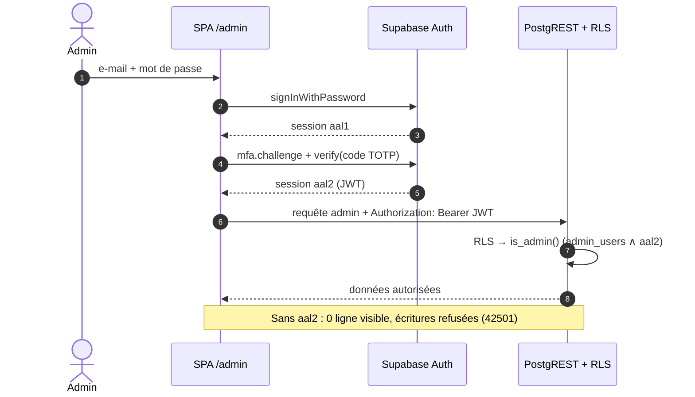

Paramètres de Supabase Auth :

- inscriptions désactivées ;
- connexion anonyme désactivée ;
- MFA TOTP activée ;
- durée de vie du JWT : 1 h, avec rafraîchissement automatique ;
- URL de redirection limitée aux domaines de l'application.

La garde des routes `/admin/*` dans la SPA sert seulement à la navigation. La vraie barrière est RLS.

#### 5.4.3. Politiques RLS (synthèse normative)

| Table | `anon` | Admin (`is_admin()`) |
|---|---|---|
| `projects`, `tracks`, `guests` | Aucune politique (lecture via `get_catalog`) | `SELECT`, `INSERT`, `UPDATE`. `DELETE` seulement si l'élément n'a jamais été choisi (contrôlé par trigger). |
| `campaign_settings` | Aucune | `SELECT`, `UPDATE` |
| `playlists` | Aucune | `SELECT`. `UPDATE` uniquement via `admin_set_playlist_status`. |
| `track_stats`, `guest_stats`, `stats_snapshot`, `share_counters` | Aucune | `SELECT` |
| `blocked_terms` | Aucune | `SELECT`, `INSERT`, `DELETE` |
| `admin_actions` | Aucune | `SELECT` (écriture par trigger uniquement) |
| `admin_users` | Aucune | `SELECT` sur sa propre ligne |
| Storage `media` | Lecture publique des objets | `INSERT`, `UPDATE`, `DELETE` |

RLS est activée sur **toutes** les tables, même celles sans politique. Le linter de sécurité Supabase doit être vierge avant chaque mise en production.

### 5.5. Gestion centralisée des erreurs

#### 5.5.1. Catalogue unique des codes (`shared/errors.ts`)

| Code applicatif | Origine | HTTP | Message affiché (rédigé dans `messages.fr`) |
|---|---|---|---|
| `validation` | Zod (Worker) ou `HUTE_*_INVALID` | 400 | Message par champ (`fields`) |
| `nickname_blocked` | `HUTE_NICKNAME_BLOCKED` | 400 | « Ce pseudo n'est pas accepté. Choisis-en un autre. » |
| `verification` | Turnstile ou honeypot | 403 | « On n'a pas pu vérifier ta participation. Réessaie dans un instant. » |
| `closed` | `HUTE_CLOSED` | 409 | « Les participations sont closes. Découvre les résultats. » |
| `inactive_items` | `HUTE_INACTIVE_ITEMS` | 409 | « Certains choix ne sont plus disponibles. Retire-les puis valide à nouveau. » (avec la liste) |
| `notice_outdated` | `HUTE_NOTICE_OUTDATED` | 409 | « Les conditions ont été mises à jour. Relis-les avant de valider. » |
| `payload_too_large` | Garde de taille | 413 | Message générique |
| `forbidden_origin` | Garde `Origin` | 403 | Message générique |
| `not_found` | Route ou tracklist inconnue | 404 | Page « Tracklist introuvable » |
| `unavailable` | Base injoignable ou timeout | 503 | « Le service est momentanément saturé. Tes choix sont gardés, réessaie. » |
| `network` | Client : `fetch` en échec ou hors ligne | — | « Pas de connexion. Tes choix sont gardés. » |
| `internal` | Tout le reste | 500 | « Un problème technique est survenu. Tes choix sont gardés, réessaie. » |

Format unique d'une réponse d'erreur :

```ts
type ApiErrorBody = {
  error: {
    code: ErrorCode;                       // valeur du tableau ci-dessus
    fields?: Partial<Record<'nickname' | 'trackIds' | 'guestIds', string>>; // clés de message, pas du texte
    items?: { trackIds?: number[]; guestIds?: number[] };                  // pour inactive_items
    requestId: string;                     // corrélation avec les journaux
  };
};
```

#### 5.5.2. Chaîne de traitement

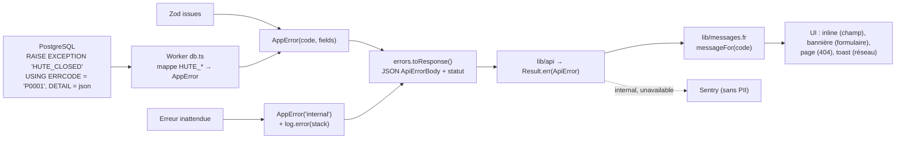

Règles :

- **La base ne produit jamais de texte pour l'humain** : seulement des codes `HUTE_*` et un détail en JSON.
- **Le Worker n'expose jamais** une trace d'appel, un message SQL ou un nom de table.
- **Le frontend** ne montre jamais un message brut venu du serveur : il traduit toujours le code.
- **Une seule `ErrorBoundary`** par zone (publique, admin) affiche un écran de repli avec « Recharger ». Les erreurs de rendu sont envoyées à Sentry.
- **Chaque erreur dans le parcours de soumission conserve le brouillon** (RG-VAL-07).
- **Le `requestId`** (dérivé de l'en-tête `cf-ray`) figure dans la réponse, dans les journaux du Worker et dans le contexte Sentry.

### 5.6. Validation à trois niveaux

| Règle | Navigateur (confort) | Worker (frontière) | PostgreSQL (vérité) |
|---|---|---|---|
| Taille de requête ≤ 4 Ko | — | Oui | — |
| Honeypot vide | (champ caché) | Oui | — |
| Turnstile | Widget | `siteverify` | — |
| Pseudo : format et longueur | Zod | Zod | `normalize_nickname` + `CHECK` |
| Pseudo : termes interdits | — | — | Oui |
| Morceaux : 1 à 20, sans doublon | Store + Zod | Zod | Fonction + `CHECK` sur la taille du tableau |
| Morceaux actifs | Purge du brouillon | — | Oui (état à l'instant T) |
| Guests : 0 à 5, sans doublon, actifs | Store + Zod | Zod | Fonction + `CHECK` |
| Campagne ouverte | Affichage | — | Oui |
| Version de notice | Constante de build | Zod (format) | Comparaison avec `campaign_settings` |
| Idempotence | Clé dans le brouillon | Format UUID | Contrainte `UNIQUE` |
| Durée de composition | Calculée | Zod (entier, 0 à 86 400) | Arrondi et bornes |

Le même module `shared/schemas.ts` est compilé dans les deux bundles (frontend et Worker). Un test vérifie que les constantes de `shared/constants.ts` sont identiques aux valeurs par défaut de la migration SQL (20, 5, 2, 24).

### 5.7. Interfaces API

#### 5.7.1. Worker

| Méthode | Chemin | Corps et paramètres | Succès | Erreurs |
|---|---|---|---|---|
| `POST` | `/api/submit` | `SubmitRequest` | `201 { code }` (création) · `200 { code }` (idempotence) | 400, 403, 409, 413, 503, 500 |
| `GET` | `/api/health` | — | `200 { ok: true, version }` | — |
| `GET` | `/t/:code` | `code` : `^[0-9A-HJKMNP-TV-Z]{10}$` | `200` HTML avec OG injectées, `X-Robots-Tag: noindex` | `200` HTML générique si le code est invalide ou inconnu (la SPA affiche l'écran introuvable) |

```ts
// shared/api-types.ts (normatif)
export type SubmitRequest = {
  nickname: string;            // 2–24 après normalisation
  trackIds: number[];          // 1–20, entiers > 0, uniques
  guestIds: number[];          // 0–5, entiers > 0, uniques
  noticeVersion: string;       // ex. "1.0"
  idempotencyKey: string;      // UUID v4
  composeDurationS: number | null; // D-2
  turnstileToken: string;
  website: string;             // honeypot, doit être ""
};
export type SubmitResponse = { code: string };
```

#### 5.7.2. PostgREST (appelé par la SPA)

| Usage | Appel | Accès |
|---|---|---|
| Catalogue | `POST /rest/v1/rpc/get_catalog` | Clé publishable |
| Statistiques | `POST /rest/v1/rpc/get_stats` | Clé publishable |
| Tracklist publique | `POST /rest/v1/rpc/get_public_playlist` `{ p_code }` | Clé publishable |
| Partage | `POST /rest/v1/rpc/increment_share` `{ p_channel }` | Clé publishable |
| CRUD admin | `GET/POST/PATCH /rest/v1/{projects,tracks,guests,blocked_terms,campaign_settings}` | JWT aal2 |
| Actions admin | `POST /rest/v1/rpc/admin_*` | JWT aal2 |
| Images | Supabase Storage `media/` | Lecture publique, écriture admin |

```ts
// Contrats de lecture (normatifs)
export type Catalog = {
  campaign: { name: string; eventLabel: string; isOpen: boolean; closesAt: string | null;
              maxTracks: number; maxGuests: number; noticeVersion: string };
  projects: { id: number; name: string; type: 'album'|'ep'|'single'|'autre'; year: number|null; coverUrl: string|null }[];
  tracks:   { id: number; projectId: number|null; title: string; type: 'solo'|'collaboration'|'freestyle'|'autre';
              year: number|null; durationS: number|null; coverUrl: string|null }[];
  guests:   { id: number; name: string; category: string|null; description: string|null; imageUrl: string|null }[];
};
export type Stats = {
  computedAt: string;
  totals: { participations: number; trackSelections: number };
  topTracks: { trackId: number; title: string; selections: number; firstPositions: number }[] | null; // null si < 10
  topOpeners: { trackId: number; title: string; firstPositions: number }[] | null;
  guests: { guestId: number; name: string; selections: number; percent: number }[] | null;
  byProject: { projectId: number|null; name: string; selections: number }[] | null;                   // null si < 50
};
```

#### 5.7.3. Versionnement des interfaces

- Les fonctions SQL sont ajoutées, jamais modifiées de façon incompatible. Un changement de contrat crée une nouvelle fonction (`get_stats_v2`), et l'ancienne est retirée après un déploiement complet du frontend.
- Le Worker et la SPA sont déployés ensemble (même artefact). Les migrations SQL sont **rétrocompatibles** avec la version précédente du frontend, selon la logique « étendre puis contracter » (expand/contract).

### 5.8. Stratégie de cache

| Ressource | Cache navigateur et service worker | Cache edge |
|---|---|---|
| Assets avec hash (`/assets/*`) | `immutable`, 1 an, précache | CDN |
| `index.html` et pages prérendues | `no-cache` (revalidation) | CDN avec revalidation |
| Polices | `immutable`, 1 an | CDN |
| `get_catalog` | Service worker *stale-while-revalidate*, 10 min | — |
| `get_stats` | **Réseau uniquement** (sondage de 60 s) | — |
| `get_public_playlist` | Réseau uniquement | Worker : Cache API, 60 s (pour l'injection OG) |
| `/api/*`, `/rest/v1/rpc/admin_*`, Auth | **Jamais en cache** | — |
| Images de Storage | Service worker *cache-first*, 7 jours, 60 entrées au maximum | CDN Supabase |

**Décision validée le 26/11/2026 :** une tracklist exclue peut encore afficher son aperçu OG jusqu'à 60 s après l'exclusion, sur le point de présence qui l'avait mis en cache. Cet aperçu est accepté. Quiconque ouvre le lien arrive sur une page qui reste utile :

- **tracklist valide** : boutons « Partager » (WhatsApp, copier le lien, partage natif) et « Composer ma set-list » ;
- **tracklist exclue ou introuvable** : message « Cette set-list n'est plus disponible », avec le bouton principal « Composer ma set-list » et un bouton secondaire « Voir les résultats ».

La page de confirmation propose aussi « Recommencer une set-list », qui ouvre un brouillon vide avec une nouvelle clé d'idempotence.

---

## 6. Modèle de données

### 6.1. Conventions

- Noms en `snake_case` et en anglais. Les libellés destinés à l'humain sont dans l'interface.
- Les identifiants du catalogue sont des `smallint` générés (`GENERATED ALWAYS AS IDENTITY`). Les tracklists ont un `bigint` interne et un `public_code` exposé.
- Toutes les dates sont en `timestamptz` (UTC), et l'affichage se fait en `Africa/Abidjan`.
- Les énumérations sont des `text` avec `CHECK`, plus simples à faire évoluer que les types `enum`.
- `created_at` et `updated_at` sont présents partout. `updated_at` est maintenu par un trigger.

### 6.2. Tables

#### `projects`

| Colonne | Type | Contraintes |
|---|---|---|
| id | smallint identity | PK |
| name | text | NOT NULL, longueur entre 1 et 120 |
| project_type | text | NOT NULL, CHECK dans (`album`, `ep`, `single`, `autre`) |
| release_year | smallint | CHECK entre 1990 et 2100 |
| cover_url | text | CHECK `^https://` |
| is_active | boolean | NOT NULL, défaut `true` |
| display_order | integer | |
| created_at, updated_at | timestamptz | NOT NULL, défaut `now()` |

#### `tracks`

| Colonne | Type | Contraintes |
|---|---|---|
| id | smallint identity | PK |
| project_id | smallint | FK vers `projects(id)` ON DELETE RESTRICT, nullable |
| title | text | NOT NULL, longueur entre 1 et 120 |
| title_search | text | GENERATED : `lower(unaccent(title))` (via une fonction immuable enveloppante) |
| track_type | text | NOT NULL, CHECK dans (`solo`, `collaboration`, `freestyle`, `autre`) |
| featured_artists | text | Facultatif, longueur ≤ 160 : artistes invités sur le morceau (« Gazo », « ElGrandeToto, La Fouine »), affichés sous la forme « feat. … ». Ajouté le 26/11/2026 lors des maquettes. |
| release_year | smallint | CHECK entre 1990 et 2100 |
| duration_seconds | integer | CHECK > 0 |
| cover_url | text | CHECK `^https://` |
| is_active | boolean | NOT NULL, défaut `true` |
| display_order | integer | |
| created_at, updated_at | timestamptz | |

Index : `(is_active, project_id, display_order)`.

#### `guests`

| Colonne | Type | Contraintes |
|---|---|---|
| id | smallint identity | PK |
| artist_name | text | NOT NULL, longueur entre 1 et 80 |
| category | text | longueur ≤ 40 |
| description | text | longueur ≤ 200 |
| image_url | text | CHECK `^https://` |
| reference_url | text | CHECK `^https://` |
| is_active | boolean | NOT NULL, défaut `true` |
| display_order | integer | |
| created_at, updated_at | timestamptz | |

#### `campaign_settings`

| Colonne | Type | Contraintes |
|---|---|---|
| id | smallint | PK, CHECK `id = 1` |
| campaign_name | text | NOT NULL |
| event_label | text | NOT NULL |
| event_date | date | |
| is_open | boolean | NOT NULL, défaut `false` |
| opens_at, closes_at | timestamptz | CHECK `closes_at > opens_at` |
| max_tracks | smallint | NOT NULL, défaut 20, CHECK entre 1 et 20 |
| max_guests | smallint | NOT NULL, défaut 5, CHECK entre 0 et 5 |
| notice_version | text | NOT NULL |
| updated_at | timestamptz | |

La campagne est ouverte si `is_open` est vrai et si l'instant courant se trouve entre `opens_at` et `closes_at`, lorsque ces dates sont renseignées (RG-CAM-03).

#### `playlists`

| Colonne | Type | Contraintes |
|---|---|---|
| id | bigint identity | PK (interne) |
| public_code | char(10) | NOT NULL, UNIQUE, CHECK `^[0-9A-HJKMNP-TV-Z]{10}$` |
| nickname | varchar(24) | NOT NULL, CHECK longueur entre 2 et 24 |
| track_ids | smallint[] | NOT NULL, CHECK `cardinality` entre 1 et 20 |
| guest_ids | smallint[] | NOT NULL, défaut `'{}'`, CHECK `cardinality ≤ 5` |
| idempotency_key | uuid | NOT NULL, UNIQUE |
| notice_version | text | NOT NULL |
| compose_duration_s | smallint | CHECK entre 0 et 3 600, nullable (D-2) |
| status | text | NOT NULL, défaut `valid`, CHECK dans (`valid`, `excluded`) |
| excluded_reason | text | CHECK dans (`insulting`, `impersonation`, `automated`, `author_request`, `other`) |
| excluded_comment | text | longueur ≤ 500 |
| excluded_at | timestamptz | |
| counted | boolean | NOT NULL, défaut `false` |
| created_at | timestamptz | NOT NULL, défaut `now()` |

Contrainte de cohérence : `(status = 'excluded') = (excluded_reason IS NOT NULL AND excluded_at IS NOT NULL)`.

Index :

- `public_code` (unique) ;
- `idempotency_key` (unique) ;
- `created_at` ;
- index partiel `(id) WHERE counted = false AND status = 'valid'`, pour que le recalcul trouve vite les nouvelles tracklists ;
- `lower(nickname)`, pour la recherche admin.

#### Statistiques

| Table | Colonnes |
|---|---|
| `track_stats` | `track_id smallint PK FK`, `selections integer NOT NULL default 0`, `first_positions integer NOT NULL default 0` |
| `guest_stats` | `guest_id smallint PK FK`, `selections integer NOT NULL default 0` |
| `stats_snapshot` | `id smallint PK CHECK (id=1)`, `payload jsonb NOT NULL`, `computed_at timestamptz NOT NULL` |
| `share_counters` | `channel text PK CHECK in ('whatsapp','native','download','copy')`, `count bigint NOT NULL default 0` |

#### Administration

| Table | Colonnes |
|---|---|
| `admin_users` | `user_id uuid PK FK → auth.users(id) ON DELETE CASCADE`, `created_at` |
| `blocked_terms` | `term text PK`, `match_mode text CHECK in ('word','substring')`, `category text`, `term_squashed text GENERATED` (forme comprimée, voir `docs/moderation/termes-interdits.md`), `created_at` |
| `admin_actions` | `id bigint identity PK`, `admin_id uuid`, `action text`, `target_table text`, `target_id text`, `details jsonb`, `created_at` |

### 6.3. Pourquoi des tableaux plutôt qu'une table de liaison

| Critère | Table de liaison `playlist_tracks` | Tableau `track_ids smallint[]` (retenu) |
|---|---|---|
| Lignes écrites par participation | 1 + 20 + 5 = 26, plus leurs index | **1** |
| Taille par participation | Environ 5 Ko | **Environ 0,3 Ko** |
| Atomicité | Transaction multi-lignes | Atomique par nature |
| Ordre | Colonne `position` à contraindre | Indice du tableau |
| Intégrité référentielle | Clé étrangère native | Vérifiée par `submit_playlist`. La suppression d'un morceau choisi est bloquée par trigger. |
| Requêtes analytiques | Jointures simples | `unnest(track_ids) WITH ORDINALITY`, aussi simple |

Avec 500 Mo de stockage gratuit et des pics d'écriture concurrente, le tableau gagne nettement. La perte de la clé étrangère native est compensée par la fonction d'écriture unique (personne d'autre n'écrit dans `playlists`) et par le trigger qui empêche la suppression d'un élément référencé. C'est l'ADR-003.

### 6.4. Cycle de vie d'une tracklist

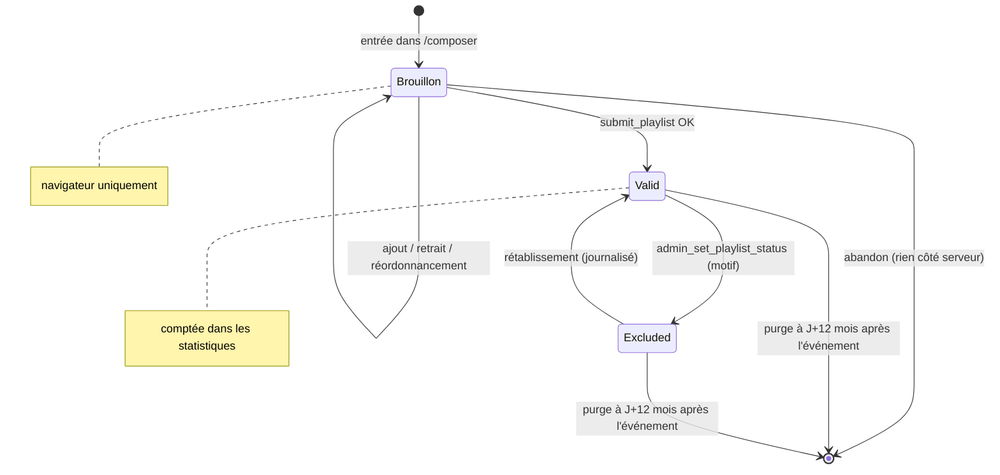

### 6.5. Volumétrie prévisionnelle

| Table | 10 000 tracklists | 100 000 tracklists |
|---|---|---|
| `playlists` avec index | Environ 4 Mo | Environ 40 Mo |
| Catalogue, statistiques, administration | Moins de 1 Mo | Moins de 1 Mo |
| **Total** | **Moins de 10 Mo** | **Moins de 50 Mo**, soit 10 % du quota |

### 6.6. Format de `stats_snapshot.payload`

Le format correspond exactement au type `Stats` du §5.7.2. Il est calculé une fois par minute et servi tel quel. Le navigateur n'effectue aucun calcul.

---

## 7. Diagramme entité-association

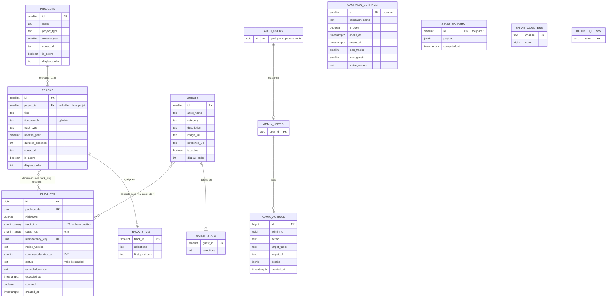

Les relations entre `TRACKS` ou `GUESTS` et `PLAYLISTS` sont **logiques** : elles passent par les tableaux, sans clé étrangère native (voir §6.3).

---

## 8. Diagrammes des flux

### 8.1. Soumission d'une participation

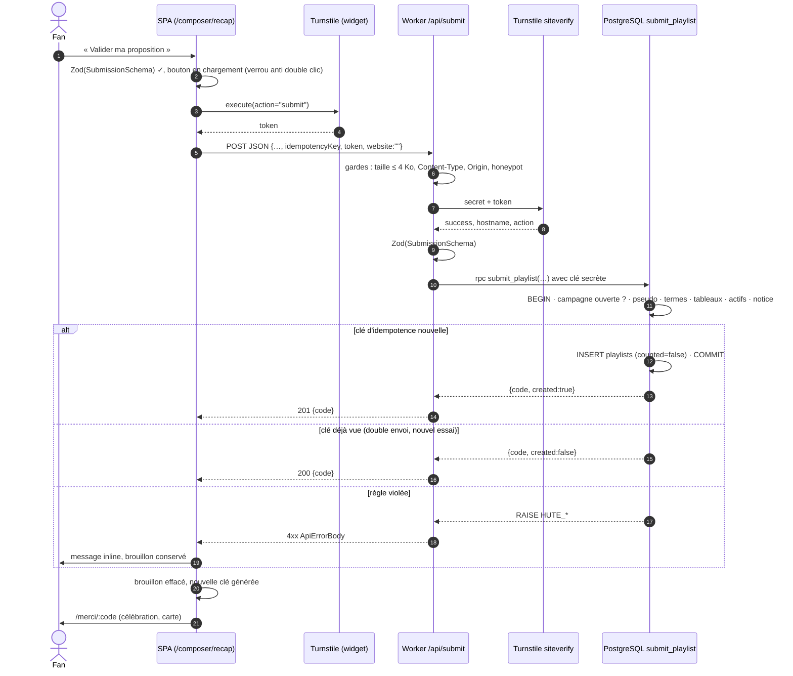

### 8.2. Calcul et lecture des résultats

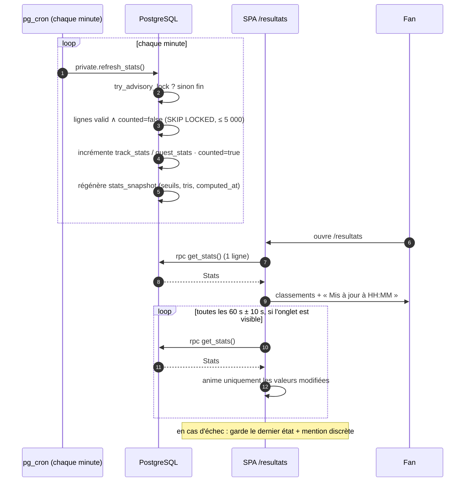

### 8.3. Partage et ouverture d'une tracklist

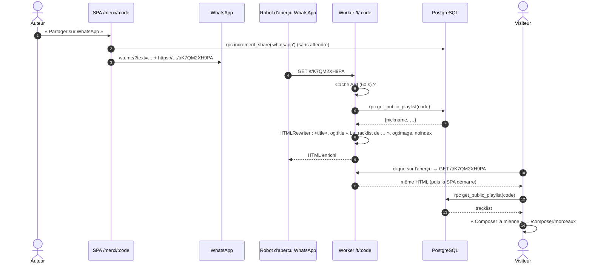

### 8.4. Modération

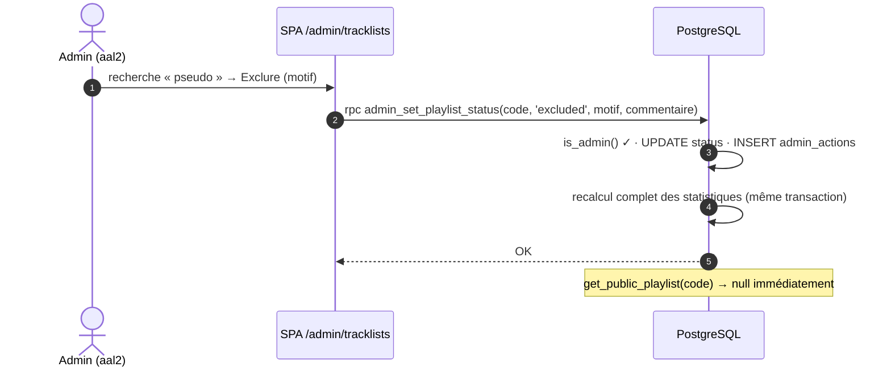

---

## 9. Structure des dossiers

```text
himra-ultra-tracklist/
├── src/                              # SPA (navigateur)
│   ├── main.tsx                      # montage, enregistrement du service worker
│   ├── entry-prerender.tsx           # rendu serveur des pages statiques (build seulement)
│   ├── app/
│   │   ├── router.tsx                # table des routes, lazy()
│   │   ├── providers.tsx             # ErrorBoundary, MotionConfig, CampaignProvider
│   │   └── layouts/                  # PublicLayout, ComposeLayout, AdminLayout
│   ├── pages/
│   │   ├── HomePage.tsx
│   │   ├── compose/                  # TracksStep, GuestsStep, RecapStep
│   │   ├── ConfirmationPage.tsx
│   │   ├── ResultsPage.tsx
│   │   ├── PublicPlaylistPage.tsx
│   │   ├── legal/                    # MentionsLegales, Confidentialite, Conditions
│   │   ├── NotFoundPage.tsx
│   │   ├── OfflinePage.tsx
│   │   └── admin/                    # Login, Dashboard, Catalog, Guests, Playlists,
│   │                                 # Moderation, Campaign, Journal, Export
│   ├── features/
│   │   ├── catalog/                  # useCatalog, search (normalisation), filters
│   │   ├── draft/                    # store, persistence, rules, useDraft
│   │   ├── submit/                   # turnstile, useSubmit
│   │   ├── share/                    # ShareCard, renderPng (lazy), useShare
│   │   ├── results/                  # useStats (polling), RankingList
│   │   └── admin/                    # supabaseClient, guards, csv (import/export), hooks
│   ├── components/
│   │   ├── ui/                       # Button, Field, Chip, Counter, Sheet, Dialog,
│   │   │                             # Bar, Skeleton, Toast, VisuallyHidden, SkipLink
│   │   ├── layout/                   # Header, Footer (mention d'indépendance), Seo
│   │   ├── tracks/                   # TrackCard, TrackList, Filters
│   │   ├── guests/                   # GuestCard, GuestGrid
│   │   └── playlist/                 # SortablePlaylist, PlaylistSummary
│   ├── lib/
│   │   ├── api.ts                    # fetch, timeout, Result, ApiError
│   │   ├── messages.fr.ts            # codes → textes (source unique)
│   │   ├── observability.ts          # Sentry lazy, analytics
│   │   ├── storage.ts                # localStorage sûr
│   │   └── format.ts                 # dates fr-CI, nombres
│   └── styles/
│       ├── tokens.css                # @theme Tailwind : couleurs, espaces, motion
│       ├── fonts.css
│       └── global.css
├── shared/                           # importé par src/ ET worker/ (aucun DOM)
│   ├── constants.ts                  # MAX_TRACKS, MAX_GUESTS, NICKNAME_MIN/MAX…
│   ├── schemas.ts                    # SubmissionSchema, NicknameSchema (Zod)
│   ├── nickname.ts                   # normalisation (miroir de private.normalize_nickname)
│   ├── errors.ts                     # ErrorCode, mapping HUTE_* → code, code → HTTP
│   ├── api-types.ts                  # SubmitRequest, Catalog, Stats, PublicPlaylist
│   └── security-headers.ts           # CSP et en-têtes (source unique)
├── worker/
│   ├── index.ts                      # entrée, withErrorHandling, requestId
│   ├── router.ts
│   ├── routes/                       # submit.ts, playlist-og.ts, health.ts
│   ├── guards.ts
│   ├── turnstile.ts
│   ├── db.ts
│   ├── headers.ts
│   └── log.ts
├── supabase/
│   ├── config.toml                   # config locale Supabase CLI
│   ├── migrations/                   # 0001_schema.sql, 0002_rls.sql, 0003_functions.sql,
│   │                                 # 0004_stats_cron.sql, 0005_audit.sql …
│   ├── tests/                        # *.test.sql : RLS, submit, stats, admin
│   └── seed.sql                      # données FICTIVES (aucun vrai titre)
├── tests/
│   ├── unit/                         # Vitest : shared/, features/
│   ├── worker/                       # Vitest : modules purs du Worker (guards, erreurs, OG)
│   ├── e2e/                          # Playwright + axe : parcours fan, admin refusé
│   └── load/                         # k6 : submit.js, read.js
├── scripts/
│   ├── prerender.ts                  # écrit le HTML statique
│   ├── gen-headers.ts                # shared/security-headers → public/_headers
│   └── check-budgets.ts              # tailles des chunks
├── public/
│   ├── fonts/  icons/  images/
│   ├── og-default.png                # 1200×630, ≤ 300 Ko
│   ├── robots.txt
│   └── _headers                      # généré
├── docs/
│   ├── cadrage/  architecture/
│   ├── adr/                          # 001-hebergement … 008-erreurs
│   ├── procedures/                   # rollback, restauration, exclusion, retrait, campagne
│   └── modele-import-catalogue.csv
├── .github/workflows/
│   ├── ci.yml                        # PR : lint, types, tests, SQL, build, budgets, audit
│   ├── deploy.yml                    # main : migrations prod → wrangler deploy
│   ├── backup.yml                    # quotidien : pg_dump chiffré
│   └── keepalive.yml                 # hebdomadaire hors campagne
├── index.html
├── vite.config.ts
├── wrangler.toml
├── tsconfig.json  tsconfig.worker.json
├── eslint.config.js
├── .env.example
├── .nvmrc                            # version LTS de Node
├── CHANGELOG.md
└── README.md
```

Règles de dépendance entre dossiers, vérifiées par le lint (`no-restricted-imports`) :

- `shared/` n'importe rien d'autre que Zod ;
- `worker/` importe `shared/`, jamais `src/` ;
- `src/features/X` n'importe pas `src/features/Y` ;
- `src/pages/admin/*` est le seul endroit qui importe `@supabase/supabase-js`.

---

## 10. Liste des dépendances

Versions **exactes**, relevées sur le registre npm le 26/11/2026. Règle appliquée : la version stable la plus récente publiée **depuis au moins 14 jours**, compatible avec les autres paquets (dépendances de pairs vérifiées). Elles sont épinglées sans `^` dans `package.json` et figées par `package-lock.json`. Les mises à jour passent par des PR dédiées (Renovate ou Dependabot, gratuits), groupées une fois par semaine, et jamais pendant un gel de déploiement.

### 10.1. Environnement d'exécution

| Outil | Version | Raison |
|---|---|---|
| Node.js | **24.22.2** (LTS « Krypton », 27/10/2026) | Exigé par wrangler (≥ 22.12), React Router (≥ 22.22) et jsdom (≥ 24.15 sur la branche 24). La branche 24 est mieux supportée par l'outillage que la 26, LTS depuis seulement octobre. Fixé dans `.nvmrc` et `engines`. |
| npm | Celui fourni avec Node 24.22.2 | `npm ci` en CI |

### 10.2. Production : navigateur

| Paquet | Version | Publiée le | Chargement | Usage |
|---|---|---|---|---|
| `react` | 19.3.1 | 14/10/2026 | Initial | UI |
| `react-dom` | 19.3.1 | 14/10/2026 | Initial | Rendu, prérendu (`react-dom/server`) |
| `react-router` | 8.5.1 | 27/10/2026 | Initial | Routes, `lazy()` |
| `motion` | 14.12.0 | 10/11/2026 | Différé | `LazyMotion` + `domAnimation` |
| `@dnd-kit/core` | 6.3.1 | 05/12/2024 | Chunk `compose` | Glisser-déposer accessible |
| `@dnd-kit/sortable` | 10.0.0 | 04/12/2024 | Chunk `compose` | Listes triables |
| `@dnd-kit/utilities` | 3.2.2 | 06/11/2023 | Chunk `compose` | Transformations CSS |
| `zod` | 4.6.7 | 12/10/2026 | Chunk `compose` (et Worker) | Validation partagée |
| `html-to-image` | 1.11.13 | 14/02/2025 | À la demande | Carte PNG |
| `@sentry/browser` | 11.12.0 | 10/11/2026 | Après le premier rendu | Erreurs |
| `@supabase/supabase-js` | 2.119.0 | 04/11/2026 | Chunk `admin` uniquement | Auth MFA, CRUD admin |
| `papaparse` | 5.7.1 | 11/11/2026 | Chunk `admin` uniquement | Import CSV |

Les paquets dnd-kit n'ont pas évolué depuis fin 2024. C'est la dernière version stable, compatible avec React 19 (pairs `>=16.8.0`). Ce point est à surveiller : la nouvelle génération `@dnd-kit/react` n'est pas retenue tant qu'elle n'est pas stable.

### 10.3. Production : Worker

| Paquet | Version | Usage |
|---|---|---|
| `zod` | 4.6.7 | Même schéma que le navigateur |

### 10.4. Développement et outillage

| Paquet | Version | Publiée le | Usage | Compatibilité |
|---|---|---|---|---|
| `typescript` | **6.0.3** | 16/04/2026 | Typage strict | TypeScript 7.0 (portage natif) est écarté : `typescript-eslint` exige `<6.1.0` |
| `vite` | 8.3.8 | 11/11/2026 | Build | |
| `@vitejs/plugin-react` | 6.3.0 | 09/11/2026 | JSX, rafraîchissement à chaud | Pair `vite ^8` |
| `tailwindcss` | 4.3.5 | 06/11/2026 | Styles | |
| `@tailwindcss/vite` | 4.3.5 | 06/11/2026 | Intégration Vite | Pair `vite ^8` accepté |
| `vite-plugin-pwa` | 2.0.0 | 03/10/2026 | Manifest, service worker | Pairs `vite ^8`, `workbox-* ^7.4.1` |
| `workbox-build` | 7.4.1 | 04/05/2026 | Génération du service worker | Pair de vite-plugin-pwa |
| `workbox-window` | 7.4.1 | 04/05/2026 | Message de mise à jour côté page | Pair de vite-plugin-pwa |
| `wrangler` | 4.160.1 | 11/11/2026 | Développement local et déploiement du Worker | Pair `@cloudflare/workers-types ^5.20261110.1` |
| `@cloudflare/workers-types` | 5.20261110.1 | 10/11/2026 | Types du runtime | Aligné sur wrangler |
| `supabase` (CLI) | 3.1.0 | 09/11/2026 | Base locale, migrations, tests SQL | |
| `vitest` | 5.1.0 | 02/11/2026 | Tests unitaires | Pair `vite ^8` |
| `jsdom` | 31.0.0 | 05/11/2026 | DOM pour Vitest | Node ≥ 24.15 |
| `@testing-library/react` | 16.3.3 | 27/08/2026 | Tests de composants | |
| `@testing-library/dom` | 10.4.2 | 13/09/2026 | Pair de testing-library/react | |
| `@playwright/test` | 1.65.0 | 05/11/2026 | Tests de bout en bout | |
| `@axe-core/playwright` | 4.14.0 | 15/10/2026 | Accessibilité en E2E | |
| `eslint` | **9.39.5** | 10/07/2026 | Lint | ESLint 10 est écarté : `eslint-plugin-jsx-a11y` ne le supporte pas encore |
| `@eslint/js` | 9.39.5 | 10/07/2026 | Règles de base | Aligné sur eslint 9 |
| `typescript-eslint` | 8.72.2 | 09/11/2026 | Lint TypeScript | Pairs `eslint ^9`, `typescript <6.1` |
| `eslint-plugin-react-hooks` | 7.1.1 | 17/04/2026 | Règles des hooks | |
| `eslint-plugin-jsx-a11y` | 6.10.2 | 26/10/2024 | Règles d'accessibilité JSX | Dernière version, eslint ≤ 9 |
| `globals` | 17.14.0 | 01/11/2026 | Globales ESLint | |
| `prettier` | 3.10.0 | 11/11/2026 | Formatage | |
| `@types/react` | 19.3.0 | 09/09/2026 | Types | |
| `@types/react-dom` | 19.3.0 | 09/09/2026 | Types | |
| `@types/papaparse` | 5.5.2 | 13/12/2025 | Types | |

Outils hors npm :

| Outil | Version | Usage |
|---|---|---|
| k6 | Dernière stable, fixée dans le workflow | Tests de charge |
| lychee (`lycheeverse/lychee-action`) | Épinglée par empreinte SHA | Liens morts |
| Actions GitHub (`actions/checkout`, `actions/setup-node`, `supabase/setup-cli`) | Épinglées par empreinte SHA | Sécurité de la chaîne d'approvisionnement |

### 10.5. Paquet écarté lors de cette vérification

| Paquet | Raison | Remplacement |
|---|---|---|
| `@cloudflare/vitest-pool-workers` 0.23.0 | Exige `vitest ^4.1`, incompatible avec vitest 5 | Les modules du Worker sont des fonctions pures, testées avec Vitest. Les routes complètes sont testées par Playwright contre `wrangler dev`. |

Toute dépendance ajoutée plus tard passe par une PR qui précise son usage, son poids compressé, le chunk où elle est chargée et l'alternative écartée.

## 11. Stratégie de déploiement

### 11.1. Environnements

| Environnement | Frontend et Worker | Base | Données | Usage |
|---|---|---|---|---|
| **Local** | `vite` + `wrangler dev` | Supabase CLI (Docker) | `seed.sql` fictif | Développement, tests |
| **Préproduction** | Worker distinct `hute-staging` (ADR-009). Chaque PR y publie une version de prévisualisation (`wrangler versions upload --env staging`) avec une URL propre | Projet Supabase `hute-staging` (gratuit n° 1) | Fictives et jeux de charge | Recette, tests de bout en bout, tests de charge |
| **Production** | Worker `hute` (`wrangler deploy`) | Projet Supabase `hute-prod` (gratuit n° 2) | Réelles | Public |

Les clés de préproduction et de production sont distinctes, ainsi que les clés Turnstile (un widget par environnement).

### 11.2. Pipeline

```mermaid
flowchart LR
  subgraph PR["Pull request"]
    A[lint + types] --> B[tests unitaires + Worker]
    B --> C["tests SQL<br/>supabase db start + test db"]
    C --> D[build + prérendu]
    D --> E[budgets de taille]
    E --> F[npm audit --audit-level=high]
    F --> G["migrations → staging<br/>wrangler versions upload"]
    G --> H["Playwright + axe<br/>sur l'URL de preview"]
  end
  H -->|revue + merge| M[main]
  subgraph PROD["Déploiement production (deploy.yml)"]
    M --> I["supabase db push (prod)<br/>migrations expand"]
    I --> J[wrangler deploy]
    J --> K["smoke test<br/>/api/health · get_catalog · /t/ code de test"]
    K -->|échec| RB["wrangler rollback<br/>+ alerte"]
  end
```

Règles :

- **Personne ne pousse directement sur `main`.** Une PR est obligatoire et la CI doit être verte (règle de protection de branche).
- **Migrations « étendre puis contracter ».** Une migration ne supprime ni ne renomme une colonne encore lue par la version en production. Le nettoyage se fait dans une migration suivante, après le déploiement.
- **Ordre fixe :** migrations d'abord, code ensuite. Le code N+1 fonctionne avec le schéma N+1. Le code N fonctionne aussi avec le schéma N+1 grâce à l'extension rétrocompatible.
- **Gel pendant les pics :** aucun déploiement non correctif dans les 48 h qui suivent une annonce attendue (story de l'artiste, annonce du concert).

### 11.3. Rollback

| Niveau | Action | Durée |
|---|---|---|
| Frontend et Worker | `wrangler rollback` (version précédente, assets compris) | Moins d'une minute |
| Base (migration fautive) | Migration corrective vers l'avant, préparée avec chaque migration risquée et décrite dans `docs/procedures/rollback.md` | Moins de 15 minutes |
| Données | Restauration de la dernière sauvegarde dans un projet temporaire, puis réimport ciblé | Moins d'une heure |

Le rollback du Worker et la restauration sont **exécutés une fois en préproduction** avant la mise en production (critère CA-NF-09).

### 11.4. Sauvegardes et continuité

- `backup.yml` est lancé chaque jour à 03:00 UTC. Il exécute `pg_dump` du schéma `public` vers la production, chiffre le résultat avec `gpg` (clé publique dans le dépôt, clé privée hors ligne chez le porteur), puis le conserve comme artefact GitHub pendant 30 jours.
- `keepalive.yml` appelle `get_stats` chaque semaine en dehors des périodes de campagne, pour éviter la mise en pause du projet Supabase.
- Sondes UptimeRobot :
  - `/` (statique) ;
  - `/api/health` (Worker) ;
  - une sonde « mot-clé » sur `get_stats`, qui vérifie la chaîne complète jusqu'à la base.

### 11.5. Secrets et configuration

| Variable | Où | Exposée au navigateur |
|---|---|---|
| `VITE_SUPABASE_URL` | Build (GitHub, par environnement) | Oui |
| `VITE_SUPABASE_PUBLISHABLE_KEY` | Build | Oui (publique par conception, sécurité assurée par RLS) |
| `VITE_TURNSTILE_SITE_KEY` | Build | Oui |
| `VITE_SENTRY_DSN` | Build | Oui (DSN public par conception) |
| `SUPABASE_URL` | Worker (`vars`) | Non |
| `SUPABASE_SECRET_KEY` | Worker (secret) | **Jamais** |
| `TURNSTILE_SECRET_KEY` | Worker (secret) | **Jamais** |
| `SUPABASE_ACCESS_TOKEN`, `SUPABASE_DB_PASSWORD` | GitHub Actions (secrets) | **Jamais** |
| `CLOUDFLARE_API_TOKEN` | GitHub Actions (secret, droits limités à Workers) | **Jamais** |

Un test de CI cherche dans `dist/` les motifs `sb_secret_`, `service_role` et les noms des variables secrètes. Le build échoue s'il en trouve un.

### 11.6. Mise en production initiale (check-list)

1. Comptes créés au nom du porteur, MFA activée sur chacun (GitHub, Cloudflare, Supabase).
2. Projets Supabase créés dans la région la plus proche disponible (Europe de l'Ouest), avec inscriptions fermées et MFA activée.
3. Compte admin créé, puis ajouté à `admin_users`.
4. Linter de sécurité Supabase vierge.
5. Tests de charge passés en préproduction (CA-NF-03).
6. Restauration et rollback testés (CA-NF-09).
7. Pages légales complètes, avec l'éditeur identifié (CA-NF-11).
8. Catalogue et guests réels importés et relus.
9. Campagne ouverte par l'admin.

---

## 12. Évolutivité

| Évolution probable | Ce qui la rend possible sans refonte |
|---|---|
| Trafic multiplié par 10 | Statique sur CDN inchangé. Passage à Workers payant (5 USD par mois) et à Supabase Pro si besoin : **aucun changement de code**. |
| Résultats à la seconde | Remplacer le sondage par un canal Supabase Realtime **broadcast** alimenté par `refresh_stats`. Le contrat `Stats` ne change pas. |
| Campagnes multiples | Ajouter `campaigns` et `playlists.campaign_id` (migration d'extension, valeur par défaut = campagne 1). Les fonctions prennent un paramètre facultatif. |
| Battles, mode live | Nouvelles features dans `src/features/` et nouvelles tables. Le noyau (catalogue, brouillon, soumission) est réutilisé. |
| Version anglaise | `lib/messages.fr.ts` devient `messages/{fr,en}.ts`, et les contenus du catalogue sont déjà neutres |
| Changement d'hébergeur | Worker sur API `fetch` standard, et PostgreSQL standard. Seul `wrangler.toml` est spécifique. |
| Carte générée côté serveur | Ajouter une route dans le Worker (offre payante pour le CPU). Le composant `ShareCard` reste la référence visuelle. |

---

## 13. Décisions d'architecture (ADR à rédiger dans `docs/adr/`)

| ADR | Décision | Statut |
|---|---|---|
| 001 | Hébergement Cloudflare Workers + Static Assets plutôt que Netlify | Accepté |
| 002 | Supabase PostgreSQL comme unique source de vérité, `anon` sans accès aux tables | Accepté |
| 003 | Tracklist en une ligne avec tableaux d'identifiants | Accepté |
| 004 | Statistiques par instantané précalculé (pg_cron, drapeau `counted`) et sondage de 60 s | Accepté |
| 005 | Soumission via le Worker (Turnstile + Zod) puis fonction SQL réservée à `service_role` | Accepté |
| 006 | Termes interdits vérifiés côté serveur uniquement (écart à RG-PSE-06) | Accepté |
| 007 | Pas de supabase-js dans le bundle public | Accepté |
| 008 | Catalogue d'erreurs unique et traduction centralisée | Accepté |
| 009 | Préproduction sur un Worker distinct (`hute-staging`) : les secrets de production ne sont jamais partagés avec une prévisualisation | Accepté (sprint 0) |

---

## 14. Conformité au référentiel dev-pro

| Exigence | Réponse architecturale |
|---|---|
| Secrets hors du frontend | §11.5 et test de CI |
| HTTPS et HSTS | Cloudflare, en-têtes dans `shared/security-headers.ts` |
| CSP, nosniff, frame-ancestors, Referrer-Policy, Permissions-Policy | `_headers` généré et `headers.ts` |
| CSRF | Pas de cookie de session public. L'admin utilise un jeton Bearer (non envoyé automatiquement). Contrôle `Origin` sur `/api/submit`. |
| Validation et échappement | Trois niveaux (§5.6). React échappe l'affichage. HTMLRewriter échappe les attributs OG. |
| Requêtes paramétrées | PostgREST et fonctions SQL, sans aucune concaténation |
| Rate limiting et honeypot | Turnstile, honeypot, taille de requête, idempotence |
| SRI | Aucun script tiers versionnable. Turnstile et le script d'analytics de Cloudflare sont exclus, car leur fournisseur interdit de les épingler. |
| Audit des dépendances | `npm audit` bloquant en CI |
| Performance (LCP, INP, CLS, moins de 500 Ko) | Prérendu, chunks, budgets en CI |
| Accessibilité | dnd-kit accessible, axe en CI, `prefers-reduced-motion` |
| Monitoring et uptime | Sentry, Workers Logs, UptimeRobot |
| Staging et prod, CI/CD, rollback, sauvegardes testées | §11 |
| Tests unitaires, d'intégration et E2E | §9 (`tests/`) et pipeline |
| README, CHANGELOG, `.env.example`, schéma versionné | §9 |
| Amélioration progressive | Pages prérendues lisibles sans JS. Exception documentée pour la composition. |
