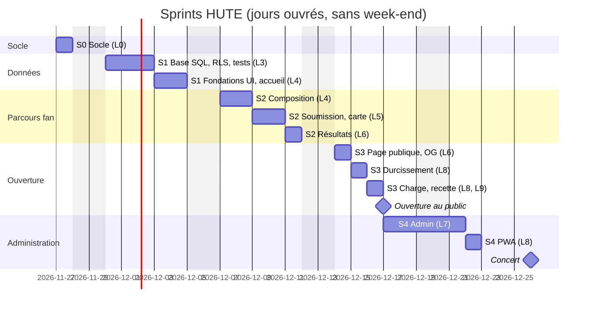

# Plan de réalisation par sprints

## HIMRA ULTRA TRACKLIST EXPERIENCE

| | |
|---|---|
| Version | 1.0, rédigée le 26/11/2026 |
| Statut | Validé le 26/11/2026. D-6 tranchée : ouverture anticipée retenue (§2) |
| Sources | Cadrage validé, architecture validée (ADR 001 à 008), direction artistique v1.0, maquettes (`docs/maquettes/README.md`) |
| Référentiel | `dev-pro` (non négociable) |

---

## 1. Point de départ et contrainte de calendrier

Les lots L1 (direction artistique) et L2 (maquettes) sont terminés et validés. Il reste les lots L0 et L3 à L9, soit **17 jours ouvrés** d'après l'estimation du CDC (§13).

| Repère | Date |
|---|---|
| Aujourd'hui | jeudi 26/11/2026 |
| Premier jour de développement possible | vendredi 27/11/2026 |
| Concert | samedi 26/12/2026 |
| Fin des 17 jours ouvrés, dans l'ordre des lots | mardi 22/12/2026 |

Si l'on suit l'ordre des lots, le site ouvre **4 jours avant le concert**, la veille des fêtes. La campagne n'aurait presque pas le temps de circuler, alors que le partage est la raison d'être du produit (objectifs métier OM-1 et OM-3 du cadrage).

Le planning ne compte **aucun week-end travaillé** et **aucune marge** au-delà d'une demi-journée. Ce sont des hypothèses explicites : si vous prévoyez de travailler le week-end, les dates avancent d'autant.

---

## 2. Décision D-6 : ouverture anticipée (retenue le 26/11/2026)

**Décision : ouvrir le site au public dès que le parcours fan est complet et durci, puis livrer l'administration pendant la campagne.**

Le périmètre du MVP ne change pas, seul l'ordre change :

| | Ordre des lots (référence) | Ouverture anticipée (recommandée) |
|---|---|---|
| Ouverture au public | mardi 22/12 | **jeudi 17/12** |
| Durée de campagne avant le concert | 4 jours | **9 jours** |
| Administration complète | 18/12 | 22/12 |
| Périmètre MVP | Complet | Complet |

**Pourquoi c'est sûr.** Les fonctions d'administration existent en base dès le sprint 1 : exclusion, termes interdits, ouverture et clôture de la campagne, recalcul. Entre le 17/12 et le 22/12, l'administrateur les appelle depuis la console SQL de Supabase, en suivant des procédures écrites et testées au sprint 3 (`docs/procedures/`). Le catalogue réel est chargé par une migration de données relue. Rien de ce qui protège le public (anti-robot, contrôles serveur, RLS, modération) n'est retardé.

**Ce que ça coûte.** Pendant 5 jours, la modération passe par la console SQL plutôt que par une interface. C'est plus lent et demande de la rigueur, mais les procédures sont courtes et le journal d'audit enregistre chaque action.

**Si D-6 est refusée**, le sprint 4 (administration) passe avant la fin du sprint 3, et l'ouverture recule au 22/12.

Le reste du document suit l'option recommandée.

---

## 3. Vue d'ensemble

| Sprint | Dates | Lots | Objectif | Jalon |
|---|---|---|---|---|
| S0 | ven. 27/11 | L0 | Dépôt, arborescence, CI, comptes, ADR | Socle prêt |
| S1 | 30/11 → 04/12 | L3, début de L4 | Base de données sécurisée et testée, fondations de l'interface, accueil | Données prêtes |
| S2 | 07/12 → 11/12 | Fin de L4, L5, début de L6 | Parcours fan réel, de la composition à la carte partagée | **Jalon 3 : parcours complet réel** (10/12) |
| S3 | 14/12 → 17/12 matin | Fin de L6, L8 (public), L9 | Partage, durcissement, recette, mise en production | **Jalon 5 : production et ouverture** (17/12) |
| S4 | 17/12 après-midi → 22/12 | L7, L8 (PWA) | Administration complète, application installable | **Jalon 4 : admin opérationnelle** (22/12) |
| Exploitation | 17/12 → clôture | | Surveillance, modération, clôture, bilan | |

---

## 4. Règles communes à tous les sprints

### 4.1. Définition de « terminé »

Une tâche est terminée quand :

1. le code est relu dans une pull request, sans push direct sur `main` ;
2. la CI est verte : lint, types, tests unitaires, tests SQL, build, budgets de taille, `npm audit --audit-level=high`, recherche de secrets dans `dist/` ;
3. les tests qui couvrent la règle de gestion concernée existent et passent. Le test est écrit avant le code pour la logique métier (`shared/`, fonctions SQL, règles du brouillon) ;
4. l'écran correspond à sa maquette à 360 px et à 1 440 px, et ses états (chargement, vide, erreur, succès) sont présents ;
5. l'écran se parcourt au clavier, sans violation axe sérieuse ou critique ;
6. les textes visibles passent par `lib/messages.fr.ts` et respectent les termes de la DA (« set-list », vocabulaire de souhaits) ;
7. aucune donnée personnelle autre que le pseudo n'apparaît dans la base, les journaux ou les exports ;
8. le `CHANGELOG.md` est mis à jour.

### 4.2. Rituels

| Moment | Contenu | Durée |
|---|---|---|
| Début de sprint | Revue des prérequis porteur, confirmation du contenu | 15 min |
| Fin de chaque journée | Point écrit : fait, prévu, bloquant | 5 min |
| Fin de sprint | Démonstration sur la préproduction, validation du jalon, rétrospective courte | 30 min |

### 4.3. Règle d'arbitrage

Les validations du porteur (revues de PR, jalons) se font **sous 24 h**, sinon le planning glisse d'autant. Si un sprint dépasse de plus d'une demi-journée, on retire d'abord ce que le CDC désigne comme reportable, dans cet ordre :

1. carte au format story (priorité C) ;
2. invite d'installation (priorité C) ;
3. classement par projet (priorité S) ;
4. tableau de bord admin réduit aux tuiles (priorité S).

Toute autre réduction est une décision du porteur.

---

## 5. Détail des sprints

### Sprint 0 : socle (vendredi 27/11, 1 jour, lot L0)

**Objectif.** Un dépôt qui compile, se teste et se déploie à vide en préproduction, avec l'arborescence de l'architecture (§9).

| # | Tâche | Résultat vérifiable |
|---|---|---|
| 0.1 | Branche de travail, protection de `main` (PR obligatoire, CI requise) | Un push direct sur `main` est refusé |
| 0.2 | Initialisation Vite, React, TypeScript strict, Tailwind, avec les versions exactes du §10 (`save-exact`) et `.nvmrc` en 24.22.2 | `npm ci` puis `npm run build` réussissent |
| 0.3 | Arborescence complète : `src/`, `shared/`, `worker/`, `supabase/`, `tests/`, `scripts/`, `public/`, `docs/adr/`, `docs/procedures/` | Conforme au §9 de l'architecture |
| 0.4 | ESLint 9 avec jsx-a11y et `no-restricted-imports` (règles de dépendance entre dossiers) | Un import de `src/` depuis `worker/` fait échouer le lint |
| 0.5 | `wrangler.toml` (Static Assets, mode SPA, `run_worker_first`, `compatibility_date` fixée), route `/api/health` | `wrangler dev` répond sur `/api/health` |
| 0.6 | `supabase init`, migration vide, `seed.sql` fictif | `supabase start` et `supabase db test` tournent en local |
| 0.7 | `ci.yml` (tout le pipeline de PR) et `deploy.yml` (préproduction seulement pour l'instant) | Une PR de test passe au vert et publie une version de prévisualisation |
| 0.8 | `.env.example`, `README.md` (installation en moins de 30 min), `CHANGELOG.md` | Un tiers lance le projet en local avec le README seul |
| 0.9 | ADR 001 à 008 rédigés dans `docs/adr/` | 8 fichiers, au format contexte, décision, conséquences |
| 0.10 | Comptes vérifiés : MFA activée partout, projets `hute-staging` et `hute-prod`, deux widgets Turnstile, Sentry, UptimeRobot | Check-list §11.6, points 1 et 2 |

**Prérequis bloquants** : comptes gratuits créés par le porteur, dates d'ouverture et de clôture souhaitées.

**Risque** : la création des comptes et l'activation de la MFA prennent souvent plus de temps que prévu. Les faire le 26/11 au soir.

---

### Sprint 1 : données et fondations (30/11 → 04/12, 5 jours, lot L3 et début de L4)

**Objectif.** Une base de données complète, verrouillée et testée, puis le système de design en code et un accueil fidèle à la maquette.

**Lundi à mercredi : base de données (L3)**

| # | Tâche | Couvre |
|---|---|---|
| 1.1 | Migration `0001_schema.sql` : `projects`, `tracks` (dont `featured_artists`), `guests`, `campaign_settings`, `playlists` (dont `compose_duration_s`), tables de statistiques, `admin_users`, `audit_log`, `blocked_terms` | Architecture §6 |
| 1.2 | Migration `0002_rls.sql` : RLS sur toutes les tables, `anon` sans accès direct | ADR-002, RG-ADM-02 |
| 1.3 | Migration `0003_functions.sql` : `get_catalog`, `get_stats`, `get_public_playlist`, `increment_share`, `submit_playlist` (réservée à `service_role`, idempotence, codes `HUTE_*`), normalisation et vérification des pseudos (modes `word` et `substring`) | ADR-005, ADR-006, RG-VAL-*, RG-PSE-* |
| 1.4 | Fonctions admin (`is_admin()` et `aal2` exigés) : catalogue, guests, exclusion et annulation avec motif, termes, campagne, recalcul complet, exports | UC-12 à UC-20 |
| 1.5 | Migration `0004_stats_cron.sql` : `refresh_stats()`, drapeau `counted`, `FOR UPDATE SKIP LOCKED`, verrou consultatif, `stats_snapshot`, planification pg_cron | ADR-004, UC-21 |
| 1.6 | Migration `0005_audit.sql` : journal de chaque action admin | RG-MOD-04 |
| 1.7 | Chargement des ~120 termes interdits et test de la liste des pseudos légitimes | `docs/moderation/termes-interdits.md` |
| 1.8 | Tests SQL (`supabase/tests/`) : chaque politique RLS, chaque refus de `submit_playlist`, double soumission, cohérence d'un recalcul complet avec le calcul incrémental | CA-08 à CA-12, CA-16, CA-18, CA-NF-05 |

**Jeudi et vendredi : fondations de l'interface (début de L4)**

| # | Tâche | Couvre |
|---|---|---|
| 1.9 | `tokens.css` (couleurs, espacements, tokens de mouvement), polices auto-hébergées en sous-ensembles, `font-display: swap` | DA §2 à §4 |
| 1.10 | Composants `ui/` : Button, Field, Chip, Counter, Sheet, Dialog, Bar, Skeleton, Toast, SkipLink, VisuallyHidden | DA, composants |
| 1.11 | `shared/` : constantes, schémas Zod, normalisation du pseudo (miroir de la fonction SQL), catalogue d'erreurs. Tests unitaires d'équivalence avec la version SQL | ADR-008 |
| 1.12 | Routeur, mises en page, prérendu des pages statiques, `lib/api.ts`, `lib/messages.fr.ts` | Architecture §4 |
| 1.13 | Accueil complet (récit au défilement, compteur, top 3, variante « campagne clôturée »), `prefers-reduced-motion` et classe `motion-lite` | Maquettes 01, 01b, 01c, CA-01 |

**Démonstration** : refus d'une soumission invalide appelée directement en SQL ; accueil en préproduction, mesuré par Lighthouse mobile.

**Prérequis** : catalogue vérifié (dont *Jeune & Riche*) et liste des guests, au plus tard le **lundi 07/12**. En attendant, le développement utilise des données fictives.

**Risques** : la règle `FOR UPDATE SKIP LOCKED` et le verrou consultatif sont la partie la plus délicate du projet. Les tests de concurrence sont écrits en premier, le mardi.

---

### Sprint 2 : parcours fan réel (07/12 → 11/12, 5 jours, fin de L4, L5, début de L6)

**Objectif.** Un fan compose, valide et obtient sa carte sur un vrai téléphone Android d'entrée de gamme, en préproduction.

| Jour | # | Tâche | Couvre |
|---|---|---|---|
| Lun. | 2.1 | Étape Morceaux : recherche insensible aux accents, filtres, « Effacer les filtres », limite de 20, titre devenu indisponible | UC-02, UC-03, CA-02, CA-03, maquettes 02, 02b, 10 |
| Lun. | 2.2 | Tiroir de set-list : glisser-déposer (dnd-kit) et boutons ↑ ↓ ×, annonces pour lecteur d'écran | UC-04, CA-05, maquette 03 |
| Mar. | 2.3 | Étape Guests : 0 à 5, étape facultative, accès direct depuis l'accueil | UC-05, CA-06, CA-07, maquettes 04, 04b |
| Mar. | 2.4 | Brouillon local (stockage sûr, reprise, conservé après une erreur réseau) | UC-08, RG-BRO-* |
| Mar. | 2.5 | Récapitulatif : pseudo, aide, consentement, champ piège | UC-06, maquettes 05, 05b |
| Mer. | 2.6 | Worker `POST /api/submit` : Zod, vérification Turnstile, appel de `submit_playlist`, traduction des erreurs, en-têtes de sécurité, journaux sans IP | ADR-005, ADR-008 |
| Mer. | 2.7 | Côté interface : Turnstile invisible, clé d'idempotence, bouton « Réessayer », messages de refus | CA-12, CA-13 |
| Jeu. | 2.8 | Confirmation : souche de billet avec le code, WhatsApp, partage natif, copie du lien | UC-07, maquette 06 |
| Jeu. | 2.9 | Carte PNG 1 080 × 1 350 (1 colonne jusqu'à 10 titres, 2 au-delà), chargée à la demande, **testée sur l'Android de référence et dans le navigateur intégré de WhatsApp** | CA-14, RT-4, maquettes 09, 18 |
| Ven. | 2.10 | Résultats : sondage de 60 s quand l'onglet est visible, onglets Titres et Guests, seuils de 10 et 50, « Actualiser », état d'échec | UC-09, D-1, D-4, maquettes 08, 08b, 11 |

**Jalon 3 (jeudi 10/12)** : parcours complet réel en préproduction, validé par le porteur sur son propre téléphone.

**Test Playwright de bout en bout** : composer, réordonner au clavier, valider, voir la confirmation. Il tourne sur chaque PR à partir de ce sprint.

**Risque principal** : l'échec de html-to-image sur certains Android (RT-4). La solution de repli (partage du lien seul) est codée en même temps que la carte, pas après.

---

### Sprint 3 : partage, durcissement et ouverture (14/12 → 17/12 matin, 3,5 jours, fin de L6, L8 public, L9)

**Objectif.** Ouvrir au public un site rapide, accessible, sûr et juridiquement complet, après avoir testé la charge, la restauration et le rollback.

| Jour | # | Tâche | Couvre |
|---|---|---|---|
| Lun. | 3.1 | Page `/t/:code` et page « plus disponible » avec boutons Composer et Résultats | UC-10, maquettes 07, 07b |
| Lun. | 3.2 | Injection des balises OG par HTMLRewriter (cache de 60 s), image par défaut 1 200 × 630, compteur de partages | CA-15, CA-17 |
| Lun. | 3.3 | Pages 404 et hors ligne, `robots.txt`, `sitemap.xml`, balises canoniques | Maquettes 12, 13 |
| Mar. | 3.4 | Mentions légales, confidentialité, conditions, avec l'identité de l'éditeur | CA-NF-11, maquettes 14 à 16 |
| Mar. | 3.5 | Sécurité : CSP et en-têtes générés depuis `shared/security-headers.ts`, HSTS, revue RLS, linter de sécurité Supabase vierge, recherche de secrets dans le bundle | CA-NF-05 |
| Mar. | 3.6 | Performance et accessibilité : budgets par chunk, LCP, INP et CLS sur mobile, audit axe de tous les écrans fan, contrastes, focus | CA-NF-01, 02, 04, 08, 10 |
| Mar. | 3.7 | **Session de tests avec 5 fans** sur leur téléphone, en préproduction | Cadrage §11.3 |
| Mer. | 3.8 | Test de charge k6 en préproduction : 20 soumissions/s et 300 lectures/s | CA-NF-03 |
| Mer. | 3.9 | Sauvegarde (`backup.yml`), restauration testée dans un projet temporaire, `wrangler rollback` testé | CA-NF-09 |
| Mer. | 3.10 | Procédures écrites et testées : exclusion, termes, campagne, retrait, rollback, restauration, **et opérations admin par la console SQL** en attendant le sprint 4 | D-6 |
| Mer. | 3.11 | Recette multi-appareils : Chrome Android, Safari iOS, WhatsApp, Chrome, Firefox et Edge sur ordinateur | CA-NF-07 |
| Jeu. matin | 3.12 | Mise en production : check-list §11.6, migration du catalogue réel relu, compte admin avec TOTP, sondes UptimeRobot, alertes Sentry, ouverture de la campagne | Jalon 5 |

**Critère d'ouverture.** Les critères CA-01 à CA-17 et CA-NF-01 à CA-NF-11 sont vérifiés, sauf ceux propres à l'interface admin (CA-19, CA-20), livrés au sprint 4. Si un seul point bloquant reste ouvert, on n'ouvre pas et on en informe le porteur.

**Prérequis bloquants** : identité de l'éditeur, contact et directeur de publication avant le **mardi 15/12** ; 5 fans testeurs disponibles le 15/12 ; termes nouchi complémentaires ; clé GPG publique pour les sauvegardes.

---

### Sprint 4 : administration et PWA (17/12 après-midi → 22/12, 3,5 jours, lots L7 et L8 restant)

**Objectif.** Remplacer les opérations par console SQL par l'interface d'administration, sans perturber le public.

| # | Tâche | Couvre |
|---|---|---|
| 4.1 | Module admin chargé à la demande (seul endroit qui importe supabase-js), connexion par e-mail et mot de passe, puis TOTP | UC-11, CA-18, maquettes A1, A1b |
| 4.2 | Campagne : état, paramètres, dialogue de clôture | UC-15, maquette A7 |
| 4.3 | Set-lists : recherche, indices d'abus, exclusion avec motif, annulation | UC-16, UC-20, maquettes A5, A5b |
| 4.4 | Modération : termes, test des faux positifs | UC-17, maquette A6 |
| 4.5 | Catalogue et guests : création, modification, activation, ordre | UC-12, UC-14, maquettes A3, A4 |
| 4.6 | Import CSV avec aperçu et blocage sur erreur | UC-13, CA-20, maquette A3b |
| 4.7 | Exports CSV protégés contre les formules | UC-18, CA-19, maquette A9 |
| 4.8 | Journal et tableau de bord (dont la durée médiane, D-2) | UC-19, maquettes A2, A8 |
| 4.9 | PWA : manifest, service worker, message de mise à jour, puis invite d'installation si le temps le permet | Maquette 11 |

L'ordre suit l'utilité pendant la campagne : d'abord ce que l'admin fait le plus souvent (campagne, exclusion, termes), ensuite le catalogue, qui sera déjà en place.

**Règles de déploiement pendant la campagne** : chaque mise en production passe par la préproduction et un test de bout en bout, aucun déploiement non correctif dans les 48 h qui suivent une annonce attendue, et le rollback est prêt avant chaque déploiement.

**Jalon 4 (mardi 22/12)** : toutes les opérations des procédures SQL sont faisables depuis l'interface, et un test E2E vérifie qu'un compte sans TOTP est refusé.

---

### Exploitation (17/12 → clôture de la campagne)

| Fréquence | Action |
|---|---|
| Chaque jour | Lecture des alertes Sentry et UptimeRobot, contrôle des quotas (alerte à 70 %), passage de modération |
| À chaque pic annoncé | Gel des déploiements pendant 48 h, surveillance renforcée |
| Clôture (date fixée par le porteur) | Fermeture par l'admin, recalcul complet, exports CSV archivés |
| Après le concert | Bilan chiffré par rapport aux objectifs du cadrage, application de la durée de conservation, réactivation de `keepalive.yml` si le site reste en ligne |

---

## 6. Prérequis du porteur et dates limites

| Élément | Bloquant pour | Date limite |
|---|---|---|
| Comptes GitHub, Cloudflare, Supabase, Sentry et UptimeRobot, avec MFA | S0 | **jeudi 26/11 au soir** |
| Dates d'ouverture et de clôture | S0 (paramétrage), S3 | vendredi 27/11 |
| Décision D-6 (ouverture anticipée) | Ordre des sprints 3 et 4 | Tranchée le 26/11 |
| Catalogue vérifié, liste des guests, visuels autorisés | Recette réelle, migration de production | lundi 07/12 |
| Termes nouchi complémentaires | Liste de modération de production | vendredi 11/12 |
| Identité de l'éditeur, contact, directeur de publication | Pages légales, ouverture | **mardi 15/12** |
| 5 fans testeurs | Validation par les utilisateurs | mardi 15/12 |
| Clé GPG publique (la clé privée reste chez vous, hors ligne) | Sauvegardes chiffrées | mercredi 16/12 |

Un prérequis manquant à sa date bloque le sprint concerné. Le développement ne le contourne pas par une valeur inventée.

---

## 7. Risques propres au planning

| ID | Risque | P | I | Mesure |
|---|---|---|---|---|
| PL-1 | Aucune marge entre l'ouverture et le concert si un sprint glisse | 3 | 3 | Ouverture anticipée (D-6), règle d'arbitrage §4.3, point quotidien |
| PL-2 | Validations du porteur au-delà de 24 h | 2 | 3 | Démonstrations courtes, jalons datés |
| PL-3 | Catalogue livré tard | 2 | 3 | Données fictives jusqu'au 07/12, catalogue réel chargé par migration au plus tard le 16/12 |
| PL-4 | Opérations admin par console SQL entre le 17 et le 22/12 | 2 | 2 | Procédures testées au sprint 3, journal d'audit, une seule personne habilitée |
| PL-5 | Déploiement de l'admin qui casse le parcours public | 1 | 3 | Module admin isolé, E2E du parcours fan sur chaque PR, rollback en moins d'une minute |
| PL-6 | Fêtes de fin d'année : disponibilité réduite des testeurs et du porteur | 2 | 2 | Tests utilisateurs placés le 15/12, avant les congés |

---

## 8. Validation

| Rôle | Nom | Date | Décision |
|---|---|---|---|
| Porteur du projet | | | |
| CTO / architecte | | | |
